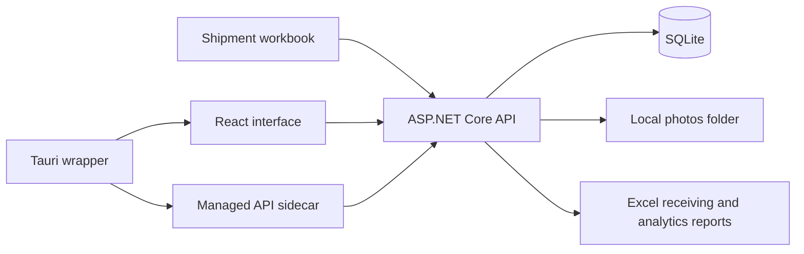

# Architecture

ShipmentCheckerPro can run as an API plus browser interface, or inside a Windows Tauri wrapper. Both modes use the same backend services and SQLite storage.

## Source responsibilities

| Directory | Responsibility |
| --- | --- |
| `backend/Controllers` | Shipment, scan, box, classification, tester, audit, authentication, and analytics routes. |
| `backend/Services` | Workbook import/export, classification rules, shipment summaries, and monthly analytics. |
| `backend/Data` and migrations | SQLite model configuration, schema evolution, and fictional first-run bootstrap. |
| `frontend/src/pages` | Receiving, verification, reporting, classification, tester, and analytics interfaces. |
| `frontend/src/lib` and stores | API client, local session state, preferences, and notifications. |
| `src-tauri` and `scripts` | API sidecar publishing, process startup/shutdown, and desktop bundles. |

The API owns business records; the frontend queries it through TanStack Query and maintains UI state with local stores. Tauri starts the published API sidecar and stops that child process when the desktop window closes.

## Persistence and boundaries

Runtime files default to `%APPDATA%\ShipmentCheckerProDemo`, with a configurable `SHIPMENTCHECKER_DATA_DIR`. SQLite stores shipments, expected items, scans, unknowns, boxes, product catalog, classification rules, tester lifecycle records, and audit sessions. File-based photos use a separate runtime folder.

Browser session storage and UI role gating are separate from API authorization. The current API does not provide a server-enforced role boundary, and local PINs are stored in plain text. Deployment hardening, remote exposure, and multiple-computer coordination are outside the validated local prototype scope.

Several models and routes anticipate future features. Their presence is not evidence that every settings, employee, adjustment, or history screen is implemented. The root README lists the known placeholder pages and chart.
